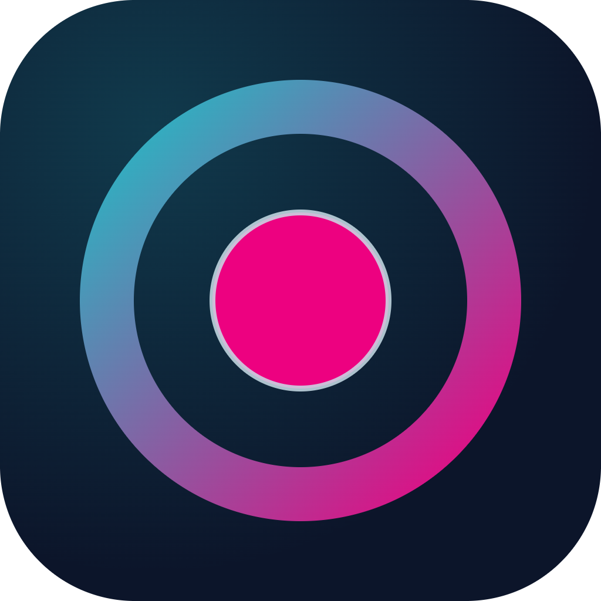

<p align="center">
  
</p>

<h1 align="center">CHELOOM</h1>

<p align="center">
  <strong>Graba tu pantalla con tu cámara flotando encima, al estilo Loom, sin cuentas y sin nube.</strong><br />
  Todo se guarda en tu computadora, listo para subir a YouTube.
</p>

<p align="center">
  <a href="https://github.com/rachelduarte/cheloom/releases/latest"></a>
  
  
  <a href="LICENSE"></a>
</p>

---

## Contenido

- [¿Qué es?](#qué-es)
- [Instalación](#instalación)
- [Primeros pasos](#primeros-pasos)
- [La cámara flotante](#la-cámara-flotante)
- [Calidad de video](#calidad-de-video)
- [Tus grabaciones](#tus-grabaciones)
- [Editar tus videos](#editar-tus-videos)
- [Atajos](#atajos)
- [Solución de problemas](#solución-de-problemas)
- [Privacidad](#privacidad)
- [Para desarrolladores](#para-desarrolladores)
- [Contribuir](#contribuir)
- [Licencia](#licencia)

---

## ¿Qué es?

CHELOOM es una app de escritorio para grabar videos explicativos, tutoriales y demos: tu pantalla y tu
cámara en un mismo video, con tu voz. Es la idea de Loom, pero **local**, **gratuita** y **de código abierto**.

| | |
|---|---|
| 🖥️ **Pantalla o ventana** | Graba la pantalla completa o una sola ventana |
| 🎥 **Cámara flotante** | Siempre visible encima de todo, en forma de **burbuja**, **cuadrado** o **rectángulo 16:9** |
| 🎨 **Marco a tu gusto** | Degradados, colores sólidos, sin marco o cualquier color que elijas |
| 🎙️ **Micrófono** | Con cancelación de eco y reducción de ruido |
| ⏯️ **Controles** | Cuenta regresiva, pausar / reanudar, detener y descartar. La barra de controles **no aparece en el video** |
| 📺 **Calidad YouTube** | MP4 H.264 a 60 fps y a la resolución nativa de tu pantalla |
| ✂️ **Editor** | Divide, borra, recorta y reordena fragmentos; al exportar todo queda pegado en un solo video |
| 📁 **Biblioteca** | Reproduce, edita, ubica o elimina tus grabaciones desde la app |
| 🔒 **100 % local** | Sin cuenta, sin servidores, sin subir nada a ningún lado |

---

## Instalación

> **Requisitos:** Windows 10 u 11 de 64 bits. Cámara y micrófono opcionales.

1. Ve a **[Releases](https://github.com/rachelduarte/cheloom/releases/latest)** y descarga `CHELOOM Setup x.y.z.exe`.
2. Ábrelo. Se instala solo en unos segundos, **sin pedir permisos de administrador**.
3. CHELOOM queda en el **Escritorio** y en el **menú Inicio**, y se abre al terminar.

### "Windows protegió tu PC"

El instalador todavía no tiene firma digital (cuesta dinero y es un proyecto personal), así que Windows
SmartScreen puede mostrar ese aviso la primera vez. Para continuar, pulsa **Más información → Ejecutar de todas formas**.

Si prefieres no confiar en un `.exe` descargado, puedes [compilarlo tú desde el código](#para-desarrolladores).

### Actualizar

Descarga e instala la versión nueva encima de la anterior. Tus grabaciones y ajustes se conservan.

### Desinstalar

**Configuración → Aplicaciones → Aplicaciones instaladas → CHELOOM → Desinstalar.**
Tus grabaciones **no** se borran.

---

## Primeros pasos

1. **Abre CHELOOM** con **`Ctrl` + `Alt` + `C`**, o desde el Escritorio o el menú Inicio.
2. La primera vez, Windows puede pedir permiso para usar la cámara y el micrófono: acéptalo.
3. En la pestaña **Grabar**:
   - Elige **qué grabar**: una de tus **Pantallas** o una **Ventana**.
   - Elige tu **cámara**, su **forma** y el **color del marco**.
   - Elige tu **micrófono** y la **calidad**.
4. Pulsa **Empezar a grabar**. Corre una cuenta regresiva de 3 segundos; **Esc** la cancela.
5. Graba. Con la barra flotante puedes **pausar**, **detener** o **descartar**.
6. Al detener, el video se abre solo en la pestaña **Biblioteca**.

> 💡 **Graba la pantalla completa** si quieres que tu cámara salga en el video. Si grabas una sola ventana,
> la cámara flotante queda fuera (la app te lo avisa).

---

## La cámara flotante

La cámara aparece en una esquina de tu pantalla, encima de cualquier app, y **sale en el video tal como la ves**.

| Quieres… | Haz esto |
|---|---|
| **Moverla** | Arrástrala con el mouse |
| **Cambiar su tamaño** | Pasa el cursor y arrastra el círculo magenta de la esquina inferior derecha |
| **Cambiar su forma** | Pasa el cursor y elige burbuja, cuadrado o rectángulo. También desde el panel. Funciona mientras grabas |
| **Cambiar el color del marco** | Panel → *Color del marco* |
| **Verte sin efecto espejo** | Panel → desactiva *Ver en espejo* |
| **Ocultarla** | Panel → Cámara → *Sin cámara* |

CHELOOM recuerda la forma, el tamaño, la posición y el color para la próxima vez.

### Colores del marco

| Opción | Color |
|---|---|
| **Degradado** *(por defecto)* | Turquesa → magenta |
| **Atardecer** | Celeste → magenta → negro |
| **Horizon · Magenta · Cloud · Lead · Blackout** | Colores sólidos |
| **Sin marco** | La cámara sin borde |
| **Personalizado** (`+`) | Abre el selector de color de Windows: cualquier color |

---

## Calidad de video

| Preset | Formato | FPS | Bitrate | Úsalo para |
|---|---|---|---|---|
| **YouTube** *(por defecto)* | MP4 · H.264 + AAC | 60 | 24 Mbps | Publicar en YouTube |
| **Máxima** | MP4 · H.264 + AAC | 60 | 40 Mbps | Editar después o archivar |
| **Liviana** | WebM · VP9 + Opus | 30 | 8 Mbps | Compartir rápido, archivos pequeños |

- Todo se graba a la **resolución nativa** de tu pantalla, sin reescalar. Debajo del selector de calidad
  ves exactamente lo que vas a obtener, por ejemplo `MP4 · H.264 · 1440p · 60 fps · 24 Mbps`.
- **Peso aproximado:** hasta ~180 MB por minuto con *YouTube* y ~300 MB con *Máxima*. Con poco movimiento
  en pantalla, los archivos salen bastante más livianos.
- Si tu equipo no puede grabar MP4, CHELOOM pasa automáticamente a WebM y te lo indica antes de grabar.

### Consejos para YouTube

- **Pantallas 1440p o 4K:** sube el video tal cual. YouTube procesa esas resoluciones con códecs de mayor
  calidad, y eso mejora la imagen incluso para quien mira en 1080p.
- **Texto pequeño:** sube el zoom de la app que vas a mostrar (125–150 %). En el celular se lee mucho mejor.
- **Audio:** un micrófono cerca de la boca vale más que cualquier ajuste de bitrate.
- **Paciencia:** recién subido, YouTube muestra primero las resoluciones bajas; la alta aparece minutos después.

---

## Tus grabaciones

Se guardan en:

```
Videos\CHELOOM\CHELOOM AAAA-MM-DD HH-mm-ss.mp4
```

Desde la pestaña **Biblioteca** puedes reproducirlas, abrir la carpeta, ubicar un archivo en el Explorador o
**eliminarlo**. Eliminar lo manda a la **Papelera de reciclaje**, así que puedes recuperarlo.

Mientras grabas, el video se escribe en disco cada segundo. Si la app se cierra de golpe, lo grabado hasta
ese momento se conserva.

---

## Editar tus videos

CHELOOM trae un editor sencillo, al estilo del de Canva: **divides** el video, **borras** lo que no quieres y
lo demás queda **pegado** en un solo video.

**Ábrelo así:** pestaña **Biblioteca** → elige una grabación → **Editar**.

### Quitar una parte del video

1. Mueve el **cabezal** (la línea magenta) al inicio de la parte que sobra y pulsa **Dividir** (o `S`).
2. Mueve el cabezal al final de esa parte y vuelve a pulsar **Dividir**.
3. Haz clic en el fragmento del medio y pulsa **Eliminar** (o `Supr`). Los fragmentos que quedan se pegan solos.
4. Pulsa **▶** para revisar cómo quedó y luego **Exportar video**.

### Todo lo que puedes hacer

| Quieres… | Haz esto |
|---|---|
| **Moverte por el video** | Haz clic en la regla de tiempo o arrastra el cabezal |
| **Dividir** | Pon el cabezal donde quieras cortar y pulsa **Dividir** (`S`) |
| **Borrar un fragmento** | Haz clic en él y pulsa **Eliminar** (`Supr`) |
| **Recortar el inicio o el final** de un fragmento | Arrastra su borde turquesa. Mientras arrastras ves el cuadro exacto del corte |
| **Recuperar algo que recortaste** | Arrastra el borde hacia afuera otra vez |
| **Cambiar el orden** | Arrastra el fragmento a otra posición |
| **Ver con más detalle** | Usa el zoom (🔍) |
| **Deshacer / rehacer** | `Ctrl` + `Z` / `Ctrl` + `Y` |

### Al exportar

- Se crea un video **nuevo**, `<nombre original> (editado).mp4`, en la misma carpeta. **El original no se toca.**
- Sale en MP4 H.264 + AAC a 30 o 60 fps constantes y a la misma resolución: listo para YouTube o para abrirlo
  en cualquier editor.
- Ves el progreso y puedes **cancelar**; si cancelas, no queda ningún archivo a medias.
- Los cortes son exactos al cuadro. Como referencia, en una PC de escritorio un video de 1440p se exporta más
  rápido que su duración real.

> Si cierras el editor con cambios sin exportar, CHELOOM te pregunta antes de descartarlos.

---

## Atajos

| Atajo | Acción |
|---|---|
| **`Ctrl` + `Alt` + `C`** | Abrir CHELOOM, o traerla al frente si ya está abierta |
| **`Esc`** (durante la cuenta regresiva) | Cancelar la grabación antes de empezar |

**En el editor:**

| Atajo | Acción |
|---|---|
| `Espacio` | Reproducir / pausar |
| `S` | Dividir en el cabezal |
| `Supr` | Eliminar el fragmento seleccionado |
| `←` / `→` | Moverse un cuadro (con `Shift`, un segundo) |
| `Inicio` / `Fin` | Ir al principio / al final |
| `Ctrl` + `Z` / `Ctrl` + `Y` | Deshacer / rehacer |

> El atajo `Ctrl` + `Alt` + `C` vive en el acceso directo del menú Inicio. Para cambiarlo:
> clic derecho en el acceso → **Propiedades** → **Tecla de método abreviado**.

---

## Solución de problemas

<details>
<summary><strong>La cámara dice "La cámara está en uso por otra app"</strong></summary>

Otra app (Zoom, Teams, Meet en el navegador, OBS…) tiene la cámara tomada. Ciérrala: CHELOOM vuelve a
intentar sola cada pocos segundos. También puedes hacer clic sobre el aviso para reintentar en el momento.
</details>

<details>
<summary><strong>La cámara dice "Sin permiso de cámara"</strong></summary>

Abre **Configuración → Privacidad y seguridad → Cámara** y activa **Acceso a la cámara** y
**Permitir que las aplicaciones de escritorio accedan a la cámara**. Para el micrófono, lo mismo en
**Privacidad y seguridad → Micrófono**.
</details>

<details>
<summary><strong>Elegí "OBS Virtual Camera" y no se ve nada</strong></summary>

Esa cámara solo entrega imagen mientras OBS tiene activada la **Cámara virtual**. Actívala en OBS o elige
tu cámara física.
</details>

<details>
<summary><strong>Mi cámara no sale en el video</strong></summary>

Estás grabando **una sola ventana**. La cámara flota encima de todo, pero no forma parte de esa ventana.
Graba la **pantalla completa**.
</details>

<details>
<summary><strong>El atajo Ctrl + Alt + C no hace nada</strong></summary>

Revisa que el acceso directo **CHELOOM** siga en el menú Inicio (si lo borraste, reinstala). Algunas apps
usan esa misma combinación; si choca con otra, cámbiala en las propiedades del acceso directo.
</details>

<details>
<summary><strong>Mi editor de video no abre bien el archivo</strong></summary>

El MP4 que generan los navegadores es *fragmentado* y de cuadros por segundo variables. YouTube lo acepta
sin problema; algunos editores antiguos prefieren convertirlo antes, por ejemplo con
[HandBrake](https://handbrake.fr/) (gratuito).
</details>

<details>
<summary><strong>¿Graba el sonido de la computadora?</strong></summary>

Todavía no: solo el micrófono. Está en la lista de mejoras.
</details>

¿Otro problema? Abre un [issue](https://github.com/rachelduarte/cheloom/issues) y cuéntanos qué pasó,
tu versión de Windows y, si puedes, una captura.

---

## Privacidad

CHELOOM **no tiene servidores ni telemetría**. No envía tus videos, tu imagen ni tu voz a ningún lado.
Todo queda en tu carpeta `Videos\CHELOOM` y tus ajustes en `%APPDATA%\CHELOOM`.

---

## Para desarrolladores

### Requisitos

- [Node.js](https://nodejs.org/) 22 o superior
- Windows 10/11 (el instalador y la exclusión de la barra de controles del video son específicos de Windows)
- `npm install` descarga FFmpeg automáticamente (paquete `ffmpeg-static`, ~83 MB)

### Correr desde el código

```bash
git clone https://github.com/rachelduarte/cheloom.git
cd cheloom
npm install
npm start
```

### Comandos

| Comando | Qué hace |
|---|---|
| `npm start` | Abre CHELOOM en modo desarrollo |
| `npm test` | Pruebas de la lógica pura (línea de tiempo, historial, FFmpeg, formas, colores, calidad, formato, errores de cámara) |
| `npm run icon` | Regenera el ícono (`build/icon.png` y `src/assets/icon.png`) |
| `npm run dist` | Genera el instalador en `dist/` |

### Cómo está hecho

- **Electron + JavaScript sin bundler.** Proceso `main`, un `preload` con `contextBridge` y páginas HTML/CSS/JS
  con módulos ES. Las páginas no tienen acceso a Node (`contextIsolation` y `sandbox` activados).
- **La cámara se compone grabando la pantalla**, donde la ventana flotante ya está visible: lo que ves es lo
  que queda en el video. La barra de controles y la cuenta regresiva usan *content protection*, así que Windows
  las excluye de la captura.
- **`MediaRecorder` escribe por fragmentos** de 1 segundo hacia `main`, que los guarda en un `.part` y lo
  renombra al terminar. La memoria se mantiene constante aunque grabes una hora.

```
src/
├── main/            proceso principal
│   ├── index.js         arranque, permisos, selección de fuente
│   ├── windows.js       panel, cámara flotante, barra, cuenta regresiva
│   ├── ipc.js           canales entre ventanas
│   ├── recorder-file.js escritura a disco por fragmentos
│   ├── library.js       biblioteca y Papelera
│   └── settings.js      preferencias
├── preload/index.cjs  API mínima expuesta a las páginas
├── renderer/          interfaz (panel, camera, toolbar, countdown) + theme.css
└── shared/            lógica pura y testeada (timeline, history, ffmpeg, shapes, frames, quality, format, camera-errors)
build/                 ícono e include NSIS (atajo Ctrl+Alt+C)
test/                  pruebas con node:test
openspec/              especificaciones de cada cambio (SDD)
```

### Paleta

| Token | Hex |
|---|---|
| Horizon | `#20BEC6` |
| Magenta | `#ED0180` |
| Dusk | `#0C152A` |
| Cloud | `#C9DEE8` |
| Lead | `#9EACB2` |
| Blackout | `#0A0F0F` |

---

## Contribuir

¡Las contribuciones son bienvenidas!

1. Haz un fork y crea una rama: `feat/mi-mejora` o `fix/mi-arreglo`.
2. Si tocas lógica de `src/shared/`, agrega o ajusta sus pruebas y corre `npm test`.
3. Usa mensajes de commit con el formato `[TAG] cheloom: descripción`, donde el tag es `[ADD]`, `[IMP]` o `[FIX]`.
4. Abre un Pull Request contando qué cambia y cómo lo probaste.

Ideas pendientes: audio del sistema, atajos globales para grabar y detener, texto y pistas superpuestas en el editor,
guardar un proyecto del editor para seguir después,
ícono en la bandeja del sistema, soporte para macOS.

---

## Licencia

[MIT](LICENSE) © 2026 Rachel Duarte

CHELOOM es un proyecto independiente, sin relación con Loom ni con Atlassian.

### Software de terceros

El editor usa **[FFmpeg](https://ffmpeg.org/)** 6.1.1 (compilación de [gyan.dev](https://www.gyan.dev/ffmpeg/builds/),
distribuida mediante [`ffmpeg-static`](https://github.com/eugeneware/ffmpeg-static)) para preparar y exportar los videos.
FFmpeg se incluye como **programa aparte** bajo la licencia **GPL-3.0-or-later**, no forma parte del código MIT de
CHELOOM. Su licencia viaja junto al ejecutable (`resources\app.asar.unpacked\node_modules\ffmpeg-static\ffmpeg.exe.LICENSE`)
y su código fuente está disponible en [ffmpeg.org](https://ffmpeg.org/download.html).
